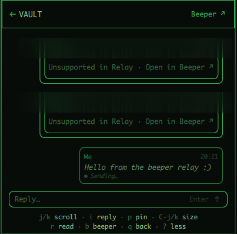
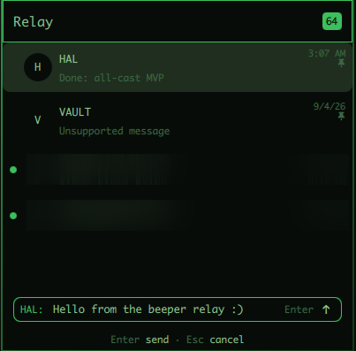
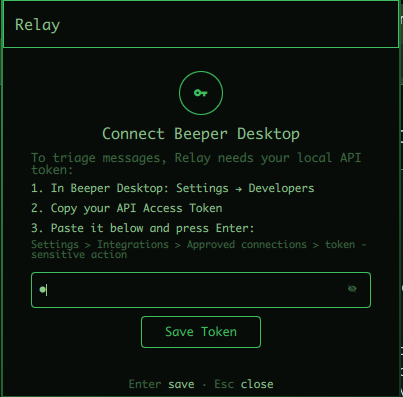

# Relay

Keyboard-first unread Beeper triage drawer for the Omarchy bar.

Relay answers one question: **who needs my attention right now, and can I handle it in one or two keystrokes?** It shows unread DMs and group chats from Beeper Desktop, lets you read the latest plain-text context, fire a quick reply, explicitly clear chats, or jump into Beeper Desktop for anything deeper. Selecting a chat never marks it read — that is always an explicit `r`.





[Demo video: replying to VAULT and scrolling HAL](assets/demo.mp4)

## Install

```sh
omarchy plugin add https://github.com/denialbb/relay --enable
```

## Remove

```sh
omarchy plugin remove denialbb.beeper-relay
```

## Setup: Beeper API token

On first run Relay shows a token prompt instead of the inbox:

1. In Beeper Desktop: **Settings → Developers**.
2. Copy your **API Access Token**.
3. Paste it into Relay's prompt and press **Enter** (or click Save Token).

## How the token is stored

- Location: `~/.config/beeper-relay/token` (pins cache: `~/.config/beeper-relay/pins.json`).
- The directory is created mode `0700`; the token file is written under `umask 077` (mode `0600`).
- Relay loads the token once at startup and sends it as an `Authorization: Bearer` header to the local Beeper API only.
- The token and message bodies are never written to logs. Pinned-chat snapshots on disk keep IDs and titles only — message previews are stripped before writing.
- Chat content is rendered as plain text; HTML in snippets is stripped.

## Dependencies

- **Beeper Desktop** running, with its local HTTP API reachable at `http://127.0.0.1:23373`.
- The `beeper://` URL scheme (used by the `b` shortcut to open a chat in Beeper Desktop).
- **Omarchy Quattro** shell / Quickshell (provides `qs.Commons`, `qs.Ui` theme tokens).
- No runtime npm dependencies. Node.js is only needed to run the test suite.

## Usage

| Key | Action |
| --- | --- |
| `j` / `k` | Next / previous chat (`Down`/`Up` also work; scroll inside a conversation) |
| `Enter` / `o` | Open selected chat |
| `i` | Quick reply from the list (`c` focuses the composer inside a conversation) |
| `Enter` / `Shift+Enter` | Send message / newline (in composer) |
| `r` | Mark active chat read (`Ctrl+r` force-refreshes the inbox) |
| `p` | Pin chat (pins sort first and survive clearing) |
| `h` | Hide / show pinned chats |
| `b` | Open chat in Beeper Desktop |
| `Ctrl+j` / `Ctrl+k` | Grow / shrink drawer (220–700px) |
| `?` | Toggle full keyboard hints |
| `Esc` / `q` | Close drawer, cancel reply, or back out of a conversation |

## Development

```sh
make check   # manifest validate + tests + complexity gate
```

See `docs/` for the spec, architecture, keymap, and security audit.
